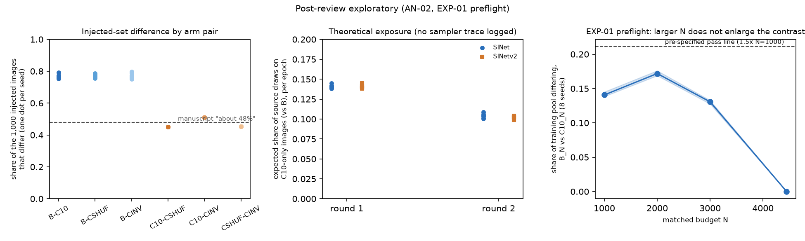
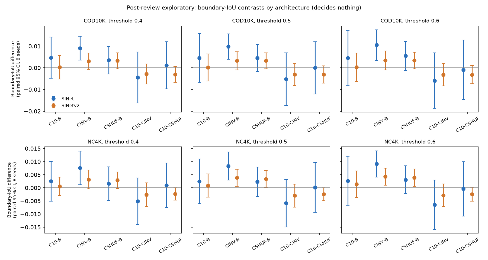
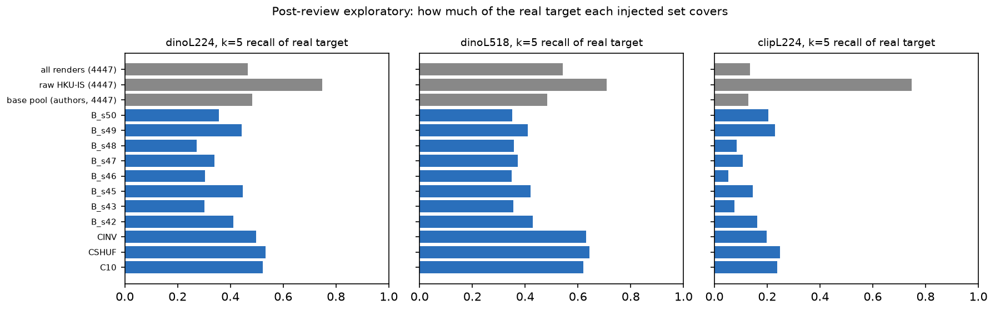
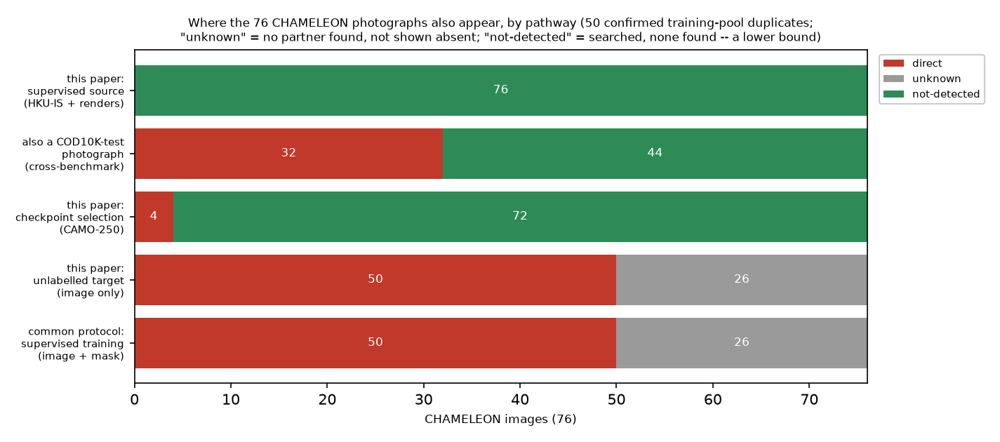

# Results summary: reviewer dypE follow-up

All results are **post-review and exploratory**, computed on CPU from the stored predictions and
selection records of the 64 committed eight-seed runs. No new training was run. Provenance:
[`EXPERIMENTAL_EVIDENCE.md`](EXPERIMENTAL_EVIDENCE.md). Status per task:
[`EXECUTION_STATUS.md`](EXECUTION_STATUS.md).

## Per-task status

| Task | Status | Headline |
|---|---|---|
| TH-01 | VERIFIED | Primary gain +0.0024, paired CI [−0.0023, +0.0070]; bound ≈ 0.006–0.007; ±0.005 equivalence not shown |
| AN-01 | VERIFIED | 1152/1152 stored values reproduce; submitted interval was Welch |
| AN-02 | PARTIALLY VERIFIED | B vs C10: 14.1% of pool differs (not 8.8%); exposure theoretical |
| TH-02 | VERIFIED | Same-shape arms share the quota multiset exactly |
| AN-03 | VERIFIED | Three-seed boundary effect gone for C10−B at eight seeds; interaction unresolved |
| EXP-02 | PARTIALLY VERIFIED | Exact re-score; CPU re-inference 3/4 within tolerance |
| AN-04 | PARTIALLY VERIFIED | Coverage, η² and correlations reproduce; concentrated sets cover more of the target than random (0.62–0.64 vs 0.35–0.43); k-NN bootstrap invalid |
| AN-05 | VERIFIED | 50/44/16 reproduced; 32 COD10K-test and 4 CAMO-250 duplicates; 74/76 duplicated somewhere |
| EXP-01 | BLOCKED | Preflight fails: larger N gives ≤ 1.22× contrast |
| EXP-03 | BLOCKED | No new-foreground generator |
| DOC-01 / DOC-02 | VERIFIED | Proposed edits with evidence |

## 1. Paired effects by architecture and endpoint (S-measure, targeted minus random, n = 8)

| Cell | Δ | Paired 95% CI | Welch 95% CI | Paired TOST ±0.005 | Seeds with Δ > 0 | ×2σ̂ (frozen rule) |
|---|---|---|---|---|---|---|
| SINet, COD10K (primary) | +0.0024 | [−0.0023, +0.0070] | [−0.0020, +0.0067] | p 0.111, not equiv. | 6/8 | 0.34, within noise |
| SINet, NC4K | +0.0003 | [−0.0038, +0.0045] | [−0.0033, +0.0040] | p 0.016, **equiv.** | 4/8 | 0.06 |
| SINet-v2, COD10K | −0.0011 | [−0.0081, +0.0059] | [−0.0067, +0.0045] | p 0.114 | 3/8 | 0.11 |
| SINet-v2, NC4K | −0.0009 | [−0.0077, +0.0058] | [−0.0068, +0.0049] | p 0.100 | 4/8 | 0.10 |

- Pairing does not help, because B redraws its images per seed: r = −0.04 and SE ratio 1.02 on the
  primary cell.
- Every cell excludes the +0.0142 reference. No cell except SINet/NC4K excludes ±0.005.
- **Conflicting outcome, reported:** reversed-signal minus random on SINet/COD10K is +0.0045
  [+0.0015, +0.0074], 7/8 seeds. That is inside the frozen bar (0.66×) and does not survive Holm over
  the 20 secondary contrasts (p 0.17).

## 2. Realised contrast and exposure

| Comparison | Shared injected images per seed | Differing share of injections | Differing share of 5,447 pool |
|---|---|---|---|
| B vs C10 | 209–246 (chance 225) | 75.4–79.1% | 14.1% (mean) |
| B vs CSHUF / B vs CINV | 214–243 / 204–250 | ≈ 77% | 14.2% |
| C10 vs CSHUF / CINV; CSHUF vs CINV | 548 / 489 / 546 (fixed) | 45.2–51.1% | 8.3–9.4% |

- Theoretical exposure under the pinned schedule: 0.74 visits per source image per epoch in round 1
  and 0.53–0.56 in round 2. C10-only images are about 14% of source draws in round 1 and about 10% in
  round 2. Actual visits are **not measured**; no sampler trace was logged.
- Round-2 pseudo-label sets: B vs C10 Jaccard 0.58–0.68. Per-arm means over 64 runs are 1991, 2007,
  2020 and 2015. The manuscript's 1977/2025/1990/1979 are over SE's 40 trained runs.
- Larger matched budgets (EXP-01 preflight): the differing pool share is 14.1% at 1000, 17.2% at 2000,
  13.1% at 3000 and 0% at 4447. This fails the 1.5× rule, and no training was justified.
- 

## 3. Boundary metrics and architecture interaction (Boundary-IoU, t = 0.5, COD10K, n = 8)

| Contrast | SINet | SINet-v2 | Interaction (SINet − SINet-v2) |
|---|---|---|---|
| C10 − B | +0.0046 [−0.0066, +0.0158], 0.30× bar (3-seed: 1.37×) | +0.0002 [−0.0061, +0.0064] | +0.0044 [−0.0075, +0.0163], p 0.43 |
| CINV − B | +0.0098 [+0.0039, +0.0157], 0.64× bar (3-seed: 1.34×) | +0.0033 [−0.0009, +0.0074] | +0.0065 [−0.0001, +0.0131], p 0.053 |

- The same pattern holds at thresholds 0.4 and 0.6, and on NC4K.
- Of 140 eight-seed contrasts, none survives Holm (smallest adjusted p 0.50). Of 70 interaction
  cells, none survives either (smallest adjusted p 1.0).
- **Negative outcome:** the submitted claim that concentration "finally clears its bar" on boundary
  metrics does not hold at eight seeds for targeted vs random.
- 

## 4. Coverage and foreground novelty
| Set (1,000 images unless noted) | k-NN recall of real target, k = 5 (dinoL518) | dinoL224 | clipL224 |
|---|---|---|---|
| Random (B), 8 independent draws | 0.349–0.428 | 0.272–0.448 | 0.053–0.229 |
| Targeted (C10) / shuffled (CSHUF) / reversed (CINV) | 0.620 / 0.644 / 0.631 | 0.523 / 0.534 / 0.498 | 0.238 / 0.248 / 0.199 |
| All 4,447 renders / authors' pool (reproduced) | 0.542 / 0.483 | 0.467 / 0.483 | 0.135 / 0.128 |
| Raw HKU-IS photographs, the generator's input (reproduced) | 0.710 | 0.747 | 0.747 |

- **Novelty:** 0 of 4,106 injected foregrounds are new. Render masks match their base masks at median
  IoU 0.968 (none identical). A render's nearest raw photograph is its own source in 43–73% of cases,
  depending on the embedder.
- **Structure:**
  - The silhouette of the committed partition is 0.156 (Euclidean, the convention behind the paper's
    0.1600) and 0.253 under cosine distance.
  - The between-cluster share of structural error is 20.5%, reproduced; it is 18.9–20.9% with each
    arm's own predictions.
- **Signal:**
  - +0.8553 / +0.4276 reproduce exactly.
  - The pixel-over-structure ordering holds for SINet, SINet-v2, SegMaR and SINet-MT, but **reverses
    for the source-only SINet baseline** (0.355 vs 0.458).
- **Domain mix:** budget-weighted CAMO share is C10 0.530, CSHUF 0.285, CINV 0.199 (pool 0.248).
  Same-shape arms differ strongly in domain, so this is a candidate, untested explanation for the
  CINV signal.
- **Conflicting outcome, reported:** the paper says targeting "covers no more of the target manifold"
  (a measure saturated near 1.0). Under the appendix's own k-NN recall, concentrated selections cover
  more than random draws of equal size, yet trained accuracy did not follow.
- **Caveat:** the pre-specified foreground bootstrap is invalid for k-NN recall, because duplicates
  shrink the radii. No interval is reported for coverage.
- 

## 5. CHAMELEON protocol pathways

| Pathway | Common supervised protocol | This paper |
|---|---|---|
| Supervised training (image + mask) | **50** direct | 0 detected (source is HKU-IS + renders) |
| Unlabelled target (image only) | n/a | **50** direct; 14–32 per run re-used with own pseudo-mask |
| Checkpoint selection (CAMO-250) | 4 if CAMO-test is used for selection | **4** (3 byte-identical + 1 re-encode) |
| Also a COD10K-test photograph | **32** (incl. all 16 "unchecked") | not an endpoint here |

- Totals: 50 confirmed, 16 unchecked and 10 same-dimension negatives (76 in all). 44 have a partner in
  COD10K-train. 74/76 are duplicated in some COD10K or CAMO split.
- Mask releases: the same predictions score MAE 0.2196 against one release and 0.0816 against the
  other.
- No score inflation is claimed.
- 

## Missing resources, unmeasured effects, implications
- **Unmeasured:**
  - realised per-image exposure (no sampler trace);
  - effects of a materially larger contrast (not producible in this pool);
  - effects of new-foreground or adaptive generation (no generator);
  - CHAMELEON score inflation (no duplicate-free model);
  - Tier B on the 10 same-dimension negatives (not run).
- **Implication for the reviewer:** the null is bounded at about 0.006–0.007 S-measure and does not
  rule out smaller gains. The concentration claim is geometric only. The architecture question is
  open. CHAMELEON is unusable as an independent endpoint under every protocol considered.
